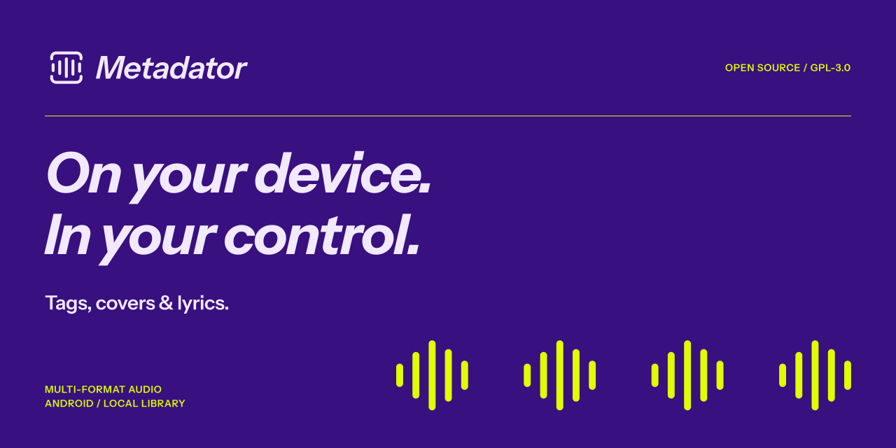

<div align="center">



# Metadator: music tag editor for Android

**Fix your music's tags, covers and lyrics. On your device, without losing a thing.**

Metadator is a free, open-source metadata editor for your local music library: MP3, FLAC, M4A,
Opus and every format TagLib reads. Find the right tags on MusicBrainz and Deezer, add album art
and synced lyrics, and fix whole albums at once.

<a href="https://play.google.com/store/apps/details?id=com.bobbyesp.metadator"></a>
<a href="https://github.com/BobbyESP/Metadator/releases/latest"></a>

[](https://github.com/BobbyESP/Metadator/releases/latest)
[](https://github.com/BobbyESP/Metadator/releases)
[](LICENSE)
[](#download)
[](https://kotlinlang.org)
[](https://developer.android.com/compose)

</div>

<!--
  Screenshots: drop four phone screenshots of the current app in assets/screenshots/ and uncomment.

<div align="center">
  
  
  
  
</div>
-->

## Why Metadator

Most tag editors either lose data or send your library somewhere else. Metadator does neither.

- **Your files stay yours.** Everything happens on your device. Only a song's title, artist and
  album leave it, and only when you search for metadata or lyrics.
- **Nothing gets lost.** Metadator writes only the fields you changed, keeps every other tag and
  picture, backs the file up first, and lets you undo any save.
- **Fast on a whole library.** Fix one song or a hundred: set an album artist or a cover for a whole
  album, number tracks, read tags from file names.

## Features

| Feature | What it does |
|---|---|
| 🏷️ **Edit every tag** | Title, artists, album, album artists, year, genres, track and disc numbers, credits, comment, BPM, ISRC, lyrics, and any other tag in the file under *All tags*. |
| 🔎 **Find metadata online** | Search MusicBrainz and Deezer at once, compare each field with what the song has, and pick what to use. Covers up to 1200 px. |
| 🎤 **Lyrics** | Find plain or synced (LRC) lyrics on LRCLIB and save them into the file. |
| 📚 **Batch editing** | Edit many songs at once: album artist, cover, track numbers, tags from file names. |
| 🧹 **A library that shows what to fix** | Search everything, sort, filter by format, and see which songs are missing tags. |
| ↩️ **Undo any save** | Every file is backed up before it is written. |
| ▶️ **A simple music player** | Background playback with the system's media controls. |
| 📂 **Open with Metadator** | From any file manager or player, no library permission needed. |
| 🎨 **Material 3 Expressive** | Colors from your wallpaper or the song's cover, and a two-pane layout on tablets and foldables. |

## Supported formats

Metadator reads and writes everything [TagLib](https://taglib.org) supports:

| Format | Extensions | Tags |
|---|---|---|
| MP3 | `.mp3` | ID3v2, ID3v1, APE |
| FLAC | `.flac` | Vorbis comments, pictures |
| AAC / ALAC | `.m4a`, `.mp4` | iTunes-style MP4 atoms |
| Ogg Vorbis / Opus | `.ogg`, `.oga`, `.opus` | Vorbis comments |
| WAV / AIFF | `.wav`, `.aif`, `.aiff` | ID3v2, RIFF INFO |
| WMA | `.wma` | ASF |
| Monkey's Audio | `.ape` | APE |

## Download

- **[Google Play](https://play.google.com/store/apps/details?id=com.bobbyesp.metadator)**: automatic
  updates.
- **[GitHub releases](https://github.com/BobbyESP/Metadator/releases/latest)**: the FOSS build, with
  no Google services and no crash reporting.

Metadator needs Android 8.0 or newer.

## Privacy

Metadator works on your device. The only thing that leaves it is a song's title, artist and album
when you search for metadata or lyrics, sent to the source you search. The Google Play build sends
anonymous crash reports; the FOSS build sends nothing. No accounts, no ads, no analytics.

## FAQ

<details>
<summary><b>How do I edit the tags of an MP3 or FLAC file on Android?</b></summary>

Open Metadator, pick the song from your library (or open the file *with Metadator* from any file
manager), change the fields you want and save. Only those fields are written; everything else in
the file stays as it was.
</details>

<details>
<summary><b>Can I add album art and synced lyrics?</b></summary>

Yes. Pick a cover from your device or from MusicBrainz and Deezer (up to 1200 px), and search
LRCLIB for plain or time-synced lyrics. Both are saved inside the audio file, so any player can show
them.
</details>

<details>
<summary><b>Can I edit a whole album at once?</b></summary>

Yes. Select several songs to set an album artist or a cover for all of them, number the tracks, or
read tags from the file names.
</details>

<details>
<summary><b>What if I save something wrong?</b></summary>

Every save can be undone: Metadator backs up a file's tags before writing them.
</details>

<details>
<summary><b>Is it free?</b></summary>

Yes. Metadator is free software under the GPL-3.0, with no ads and no in-app purchases.
</details>

## Build it

Requirements: JDK 21 and the Android SDK (compile SDK 37).

```bash
./gradlew :app:assembleFossDebug   # an APK without Google services
./gradlew test                     # unit tests
./gradlew spotlessApply            # format before committing
```

How the code is organized, and the rules for changing it, are in [AGENTS.md](AGENTS.md) and
[docs/](docs/README.md).

## Translations

Metadator is translated into Arabic, Chinese (Simplified), Dutch, English, French, German, Hindi,
Italian, Japanese, Korean, Portuguese, Russian and Spanish. Corrections and other languages are
welcome: copy `src/main/res/values/strings.xml` of each module into `values-<language>/`, keeping
the order and the comments of the English file.

## Contributing

Bug reports and ideas are welcome in [Issues](https://github.com/BobbyESP/Metadator/issues). If
Metadator is useful to you, a ⭐ on GitHub helps other people find it.

## License

Metadator is free software, licensed under the [GPL-3.0](LICENSE). Instrument Sans, the brand
typeface bundled with the app, is licensed under the
[SIL Open Font License 1.1](https://openfontlicense.org).

<div align="center">
<br/>
<picture>
  <source media="(prefers-color-scheme: dark)" srcset="./assets/logo_dark.svg">
  
</picture>
</div>
